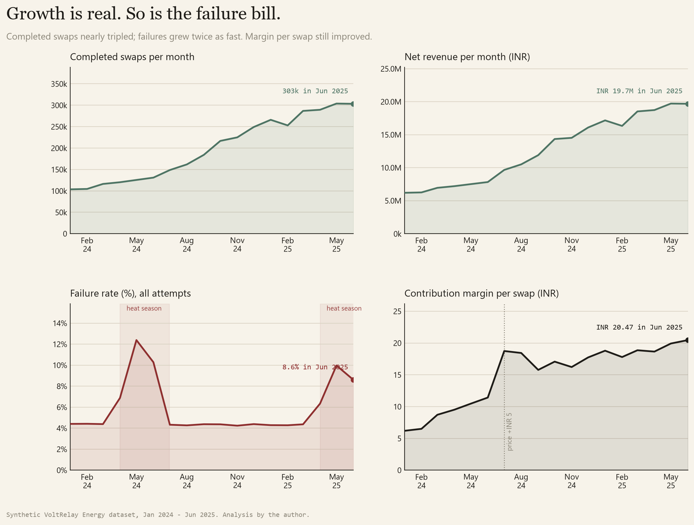
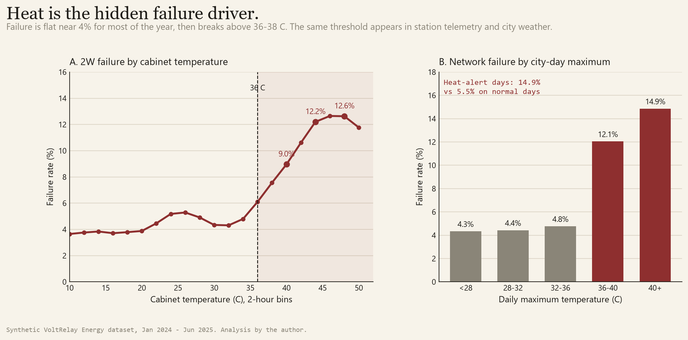
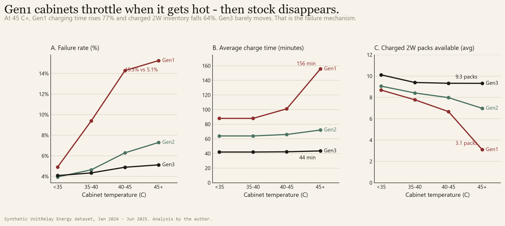
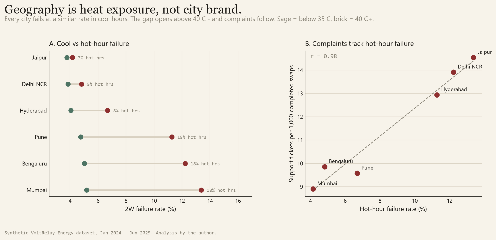
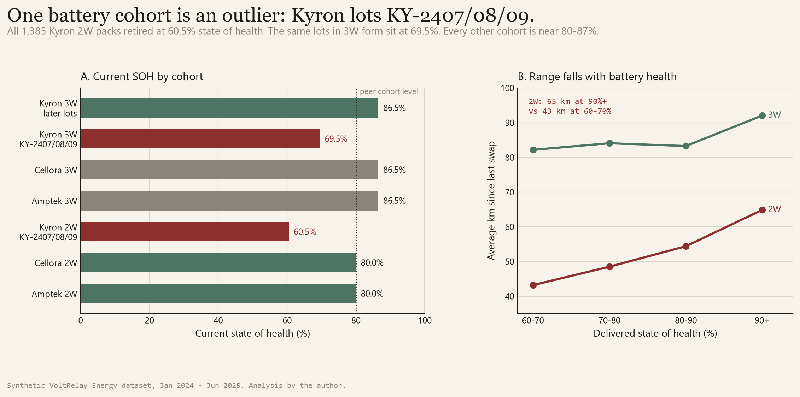
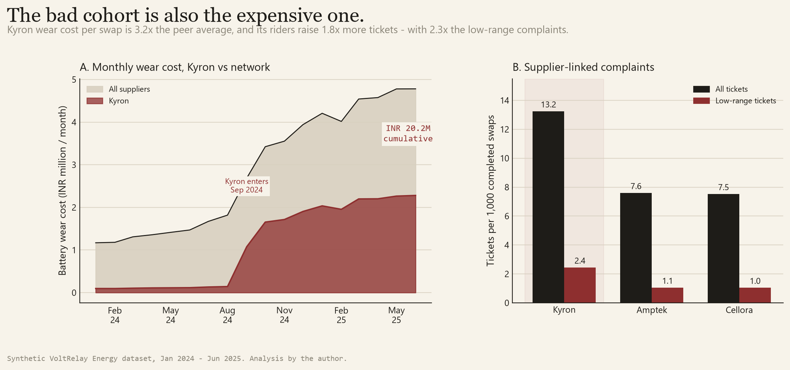
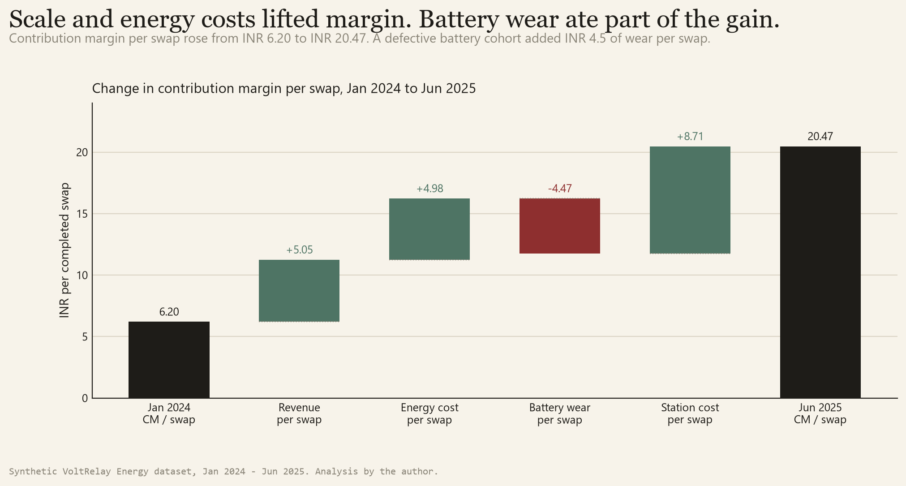
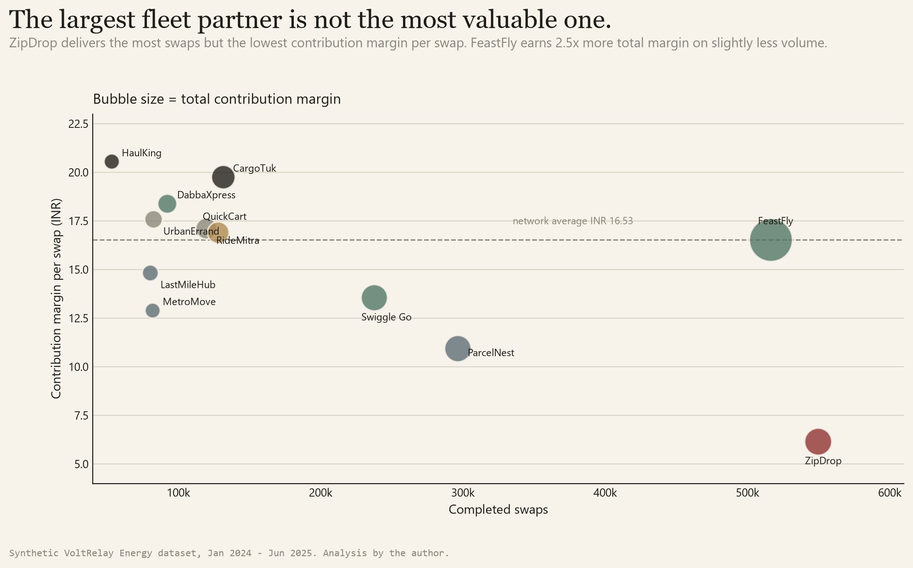
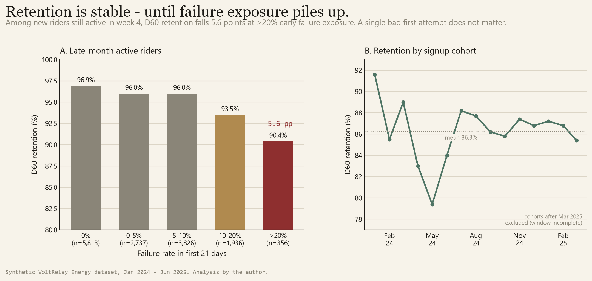
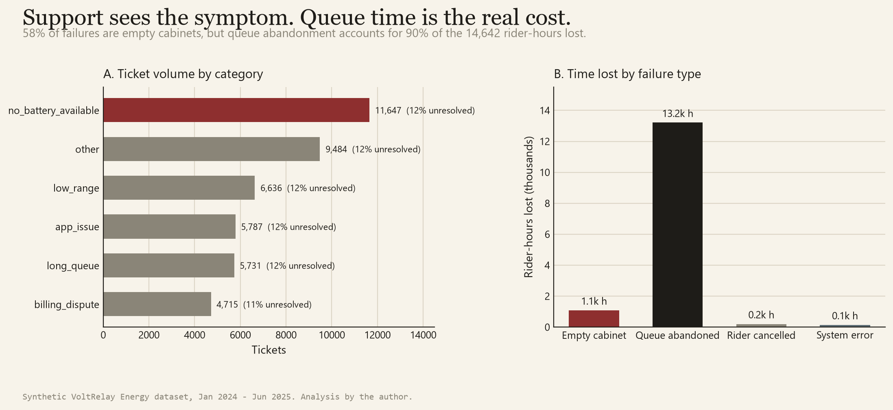

# VoltRelay Energy — From Growth to Profitable Growth

**Analysis Report**

Gradient Learnings Data Analytics Hackathon  
Synthetic VoltRelay network dataset · January 2024 – June 2025 · 6 Indian cities

---

## 1. Problem understanding

VoltRelay operates a battery-swapping network for two- and three-wheelers. In 18 months it nearly tripled completed swaps, expanded across six cities, and added fleet partners. The operating question is no longer whether demand exists. It is whether the network can grow **without buying volume through service failure, discounting, and premature battery wear**.

The brief asks six core questions:

1. Do swaps, revenue, failure rate and contribution margin tell the same story over time?
2. Which service failures hurt riders most, and where and when do they occur?
3. Do station generation, geography and equipment explain performance?
4. Do battery cohorts explain range, swap frequency and cost?
5. Are pricing and partner contracts creating value or buying volume?
6. What actually drives new-rider churn?

The analysis answers those questions and then converts them into a capital-allocation recommendation: **more stations, more batteries, pricing changes, or fixing the assets already in the field?**

The dataset is synthetic. Every mechanism below is internally consistent and reproducible from the notebook. Rupee levels are illustrative, not a claim about a real company.

---

## 2. Analytical approach

### 2.1 Data and grain

| Table | Rows | Grain | Role |
|---|---:|---|---|
| `swap_events` | 3,877,013 | one rider attempt | revenue, failures, queue, tariff, battery in/out |
| `station_hourly_status` | 1,487,712 | station × hour | cabinet temperature, charge time, inventory, telemetry |
| `riders` | 20,000 | rider | plan, channel, vehicle class, partner |
| `batteries` | 6,500 | pack | supplier, lot, SOH, cost, retirement |
| `support_tickets` | 44,000 | ticket | category, free text, resolution, CSAT |
| `stations` | 152 | station | generation, location, rent, tariff, wave |
| `city_daily_context` | 3,282 | city × day | weather, heat alerts, outages, events |
| `fleet_partners` | 12 | partner | discount, amendment, payment terms |

### 2.2 Cleaning decisions

| Issue | Evidence | Treatment |
|---|---|---|
| Firmware timezone bug | `v3.2.0`, 10 Mar–15 Apr 2025, +330 min | Correct timestamps; flag; do not drop |
| Offline retry duplicates | same rider/station/battery within 180s | remove near-duplicates |
| Test stations | `STN-TST*`, 62,031 events | exclude from every metric |
| City spellings | 16 variants for 6 cities | normalise to six canonical cities |
| Invalid distance | `km_since_last_swap` outside 0–300 km | null for range analysis |
| SOC > 100 | 3,698 rows | keep; excluded from range analysis |
| Telemetry gaps | 36,987 partial + 9,384 missing rows | retain; failure rate similar (6.2% vs 6.0%) |

After cleaning: **3,814,982 attempts**, **3,586,675 completed swaps**, **228,307 failures** and **₹229.2M net revenue**.

### 2.3 Contribution margin model

For every completed swap:

- **Revenue:** `amount_charged_inr` (net of discount).
- **Energy:** `energy_to_recharge_kwh × grid_tariff_inr_kwh`.
- **Battery wear:** `purchase_cost × ΔSOH/100 ÷ observed cycles`; packs with fewer than 50 cycles use the pack-type median.
- **Station fixed cost:** monthly rent + maintenance allocated over that station-month's completed swaps.

`cm_full` includes all four layers. Excluding station cost gives `cm_var`; the full version is the honest operating view.

### 2.4 Methods used

- **DuckDB** out-of-core SQL over Parquet for the full 3.8M-row event table.
- **Stratified baseline** for heat-attributable failures: failure rate below 35°C within the same vehicle class and peak/off-peak segment.
- **Paired within-station comparison** for hot versus cool hours, controlling for location.
- **Difference-in-differences style before/after** for the ZipDrop amendment and the peak-pricing pilot.
- **Time-ordered retention windows**: exposure days 0–21, sample condition active days 22–30, outcome days 31–60. This removes the mechanical link between usage volume and the retention window.
- **Logistic regression** for retention, with median imputation, standardisation, plan/channel/city/vehicle controls, and a 100-iteration bootstrap confidence interval.
- **Regex keyword coding** of English/Hinglish support comments as a directional check on the taxonomy.

---

## 3. Key insights

### 3.1 Growth is real; the failure bill is growing faster

- Completed swaps grew **2.9×**, from ~104k to ~303k a month.
- Monthly failures grew **6.0×**, from **4,770 to 28,523**.
- The failure rate doubled from **4.41% to 8.60%**, while net revenue per swap moved only from **₹59.9 to ₹64.9** despite a ₹5 list-price increase in July 2024.
- Contribution margin per swap improved from **₹6.20 to ₹20.47**, but mostly because fixed station cost was diluted by volume (₹20.38 → ₹11.68 per swap). Energy contributed +₹4.98 and revenue +₹5.05; battery wear took back **−₹4.47**.

The four metrics do **not** tell the same story. Growth is genuine, but it is being purchased with service quality and battery health.

### 3.2 Heat is the primary failure mechanism

Failure is flat near 4% until cabinet temperature reaches **36–38°C**, then rises to **12–15%**. City-day maximum temperature mirrors the curve: **12.05%** at 36–40°C and **14.86%** at 40°C+, versus **4.34–4.77%** below 36°C. Heat-alert days fail at **14.93%** versus **5.51%** on normal days.

The mechanism is equipment-specific:

| At 45°C+ | Gen1 | Gen3 |
|---|---:|---:|
| Charge time | **155.7 min** | **43.5 min** |
| Charged 2W inventory | **3.10 packs** | **9.32 packs** |
| Failure rate | **15.25%** | **5.12%** |

Holding vehicle class and peak hour constant, **39,445 failures are heat-attributable** — **17.3%** of all failures — worth roughly **₹2.52M of forgone revenue** at the average ticket.

Geography is heat exposure, not city brand. Every city fails at a similar rate in cool hours; Jaipur, Delhi NCR and Hyderabad separate only when cabinets run above 40°C. Mumbai and Bengaluru look better largely because they spend fewer hours there. **121 of 138** paired stations are worse when hot.

### 3.3 The battery problem is a lot-level outlier

Kyron lots **KY-2407/08/09** are the single clearest asset-quality problem:

- **60.5% SOH** versus **80.0%** for peer 2W packs.
- All **1,385 Kyron 2W packs retired** at 60.5% (`end_of_life`), after **402 swaps/pack** versus **643** for peers.
- Wear cost **₹30.79/swap** versus **₹9.56** — **3.2×**.
- Cumulative Kyron wear **₹20.2M**; the avoidable premium is roughly **₹12.7M**.
- **13.24 tickets per 1,000 swaps** versus **7.55** for peers; **2.44 low-range tickets** versus ~1.04. Kyron is 18.2% of swaps but **34.2% of low-range complaints**.
- 2W range falls from **64.9 km at 90%+ SOH** to **43.2 km at 60–70%**.

The same lots in 3W form sit at **69.5%**, while later Kyron 3W lots reach **86.5%**. This is lot-specific, not inherent to the supplier — so the remedy is contract and acceptance discipline, not a blanket brand exit.

### 3.4 The largest partner is the weakest economically

- **ZipDrop:** 549,390 swaps, **₹6.17 CM/swap**, **₹3.39M total CM**.
- **FeastFly:** 516,367 swaps, **₹16.54 CM/swap**, **₹8.54M total CM**.
- Network average: **₹16.53 CM/swap**.
- ZipDrop's revenue per swap fell from **₹57.48 to ₹48.64** after the amendment — a **~₹2.97M revenue give-up** on 336k post-amendment swaps.

Pricing is not the margin engine. The July 2024 list-price increase did not reach net revenue per swap. PEAK swaps earn **₹41.29** versus **₹19.81** for STD, but the pilot is small (163,922 swaps, only Bengaluru and Pune).

### 3.5 Retention is downstream of repeated failure exposure

- Base D60 retention among late-month-active new riders: **95.9%**.
- Riders with **no early failures: 96.9%**; riders above **20% early failure exposure: 90.4%** — a **5.6-point** gap.
- **15.6%** of the sample is above 10% early failure exposure.
- Adjusted odds ratio: **0.64 per +10pp failure exposure** (95% CI **0.547–0.725**), controlling for usage volume, wait, SOH, peak share, plan, channel, city and vehicle class. Model AUC **0.627** — the direction is robust, the individual prediction is modest.
- A failed **first** attempt has no independent effect on activation. What matters is whether failures keep happening.

Retention is therefore not a separate CRM problem. It is the downstream consequence of the same empty-cabinet, hot-hour experience.

### 3.6 Support sees the symptom, not the mechanism

Of 44,000 tickets: **11.8% unresolved**, **2.1% duplicates**, average resolution **16 hours**, CSAT **3.55**.

`no_battery_available` is the largest category (11,647 tickets, 26%). Keyword coding finds **2,887 queue/line/wait mentions inside that category** — roughly a quarter of "no battery" tickets are really congestion. `low_range` (6,636) is the rider-visible battery-quality signal, and Kyron is heavily over-represented in it. Partner escalations resolve in **8.2 hours** versus **16.8 hours** overall, showing the value of a dedicated lane.

---

## 4. Business findings

### 4.1 The P&L is improving for the wrong reason

The network earns **₹59.29M contribution on ₹229.2M revenue (25.9%)**. The improvement in CM/swap is real, but it comes from **fixed-cost dilution**, not pricing power. If volume growth slows, station cost per swap rises again and the margin story reverses. Meanwhile battery wear is moving the wrong way, driven by a single supplier cohort.

### 4.2 Failure is concentrated, physical, and fixable

Failures are not uniformly spread across the network. They concentrate in hot hours, at Gen1 cabinets, and in cities with more hours above 40°C. The heat-attributable failure estimate is conservative because it uses a within-segment cool-hour baseline. This is the rare operations problem with a clear physical lever.

### 4.3 Battery quality is a procurement problem before it is a maintenance problem

The Kyron lots retired at exactly 60.5% SOH, with 100% retirement and a 3.2× wear premium. That pattern is consistent with a bad incoming lot or an acceptance threshold that was too loose, not with random field failure. The cost is visible in wear, range complaints, and rider churn.

### 4.4 Volume from the largest partner is destroying margin

ZipDrop is 549k swaps but earns **₹6.17** per swap against a **₹16.53** network average. The amendment reduced revenue per swap by ~₹8.84. Growing this contract without reversing the discount scales the least profitable volume in the network.

### 4.5 Churn is an operations KPI, not just a marketing KPI

The retention model says a 10-point increase in early failure exposure reduces the odds of returning by **36%**. The 15.6% of new riders above 10% exposure represent a meaningful at-risk cohort every month. Fixing heat and congestion is therefore a retention intervention, not only a cost intervention.

---

## 5. Recommendations

### Priority 1 — Retrofit or upgrade Gen1 cabinets for heat (0–90 days)

**Why:** Gen1 fails at 15.25% versus 5.12% at 45°C+; 39,445 heat-attributable failures; charge time 156 versus 44 minutes; inventory 3.1 versus 9.3 packs.

**What:** ventilation/shade, active cooling where feasible, charge-profile derating during heat alerts, and a paired pilot on the 20 worst Gen1 stations.

**Measure:** failure rate above 40°C, charge minutes, charged inventory, D60 retention in the post-fix cohort.

### Priority 2 — Quarantine Kyron lots and tighten acceptance (0–60 days)

**Why:** 60.5% SOH, 100% retirement, ₹30.79 versus ₹9.56 wear/swap, 2.4× low-range tickets.

**What:** quarantine KY-2407/08/09; return/replace under warranty; add incoming SOH and range acceptance thresholds; require lot-level traceability in future contracts.

**Measure:** SOH at intake, low-range tickets per 1,000 swaps, wear per swap.

### Priority 3 — Reopen ZipDrop terms or cap growth (30–90 days)

**Why:** ₹6.17 versus ₹16.53 CM/swap; ~₹2.97M revenue give-up post-amendment.

**What:** renegotiate the discount step-up; make peak surcharge billable; tie volume commitments to margin floors. Do not pursue exclusivity without reversing the discount.

**Measure:** CM/swap by partner, discount realisation, revenue per swap.

### Priority 4 — Extend PEAK pricing beyond the two-city pilot (60–120 days)

**Why:** PEAK earns ₹41.29 versus ₹19.81 CM/swap.

**What:** extend to Hyderabad and Delhi NCR with a controlled rollout; protect low-income riders with off-peak incentives; monitor peak share and churn.

**Measure:** peak share, CM/swap, rider retention by tariff segment.

### Priority 5 — Treat queue abandonment as a top-tier service incident

**Why:** abandonment is ~90% of 14,642 rider-hours lost; p90 wait 1,088 seconds.

**What:** live queue visibility, virtual queuing, station-level alerts when charged inventory falls below a threshold, and a dispatch rule that diverts riders before they abandon.

**Measure:** abandonment rate, p90 wait, tickets per 1,000 swaps.

### Priority 6 — Only then add stations or batteries, targeted by heat and abandonment

**Why:** uniform expansion replicates the same failure mode at higher fixed cost. 121 of 138 paired stations are worse when hot.

**What:** prioritise hot, high-abandonment cells with Gen3 cabinets; use battery additions to replace the Kyron cohort, not to grow the fleet blindly.

**Measure:** station-month CM, failure rate, payback.

### What not to do

- Do not add stations uniformly to chase swap growth.
- Do not sign an exclusive ZipDrop deal without reversing the discount.
- Do not treat support-ticket volume as the primary KPI; it lags the physical failure.

### 30-60-90 day plan

| Window | Actions | Decision gate |
|---|---|---|
| Days 0–30 | Heat retrofit pilot on 20 worst Gen1 stations; quarantine Kyron lots; queue-abandonment incident | Pilot instrumentation live; quarantine complete |
| Days 31–60 | Paired pilot readout; ZipDrop renegotiation; PEAK extension design | Failure delta and retention signal significant |
| Days 61–90 | Scale retrofit if the delta holds; lock battery acceptance terms; re-run retention model | Payback and churn improvement confirmed |

---

## 6. Limitations

- The dataset is synthetic; the mechanisms are internally consistent, but rupee levels are illustrative.
- Heat attribution uses a stratified observational baseline, not a randomised experiment. A paired retrofit pilot is the correct causal test.
- The retention model is observational. Time-ordered windows and volume controls reduce, but do not eliminate, unobserved rider-quality confounding. AUC 0.627 means the model is useful for direction, not individual targeting.
- Support-text keyword coding is directional; a human-labelled Hinglish taxonomy would improve it.
- May–June 2025 cohorts have incomplete 90-day windows. The direction is informative; the level is biased downward.
- Battery wear uses purchase cost × SOH consumption per observed cycle. It excludes salvage and second-life value, so it is a conservative operating cost.

---

## 7. Reproducibility

- Notebook: `VoltRelay_Data_Analytics_Hackathon.ipynb` — runs top-to-bottom in Colab; builds cleaned Parquet from the eight CSVs, then reproduces every table and chart.
- Chart data: `outputs/chart_data/`
- Publication charts: `outputs/charts/`
- Machine-readable findings: `outputs/findings.json`

All analysis is deterministic. The only stochastic component is the bootstrap confidence interval for the retention odds ratio (100 iterations, seed 42).
